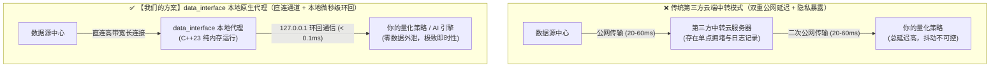
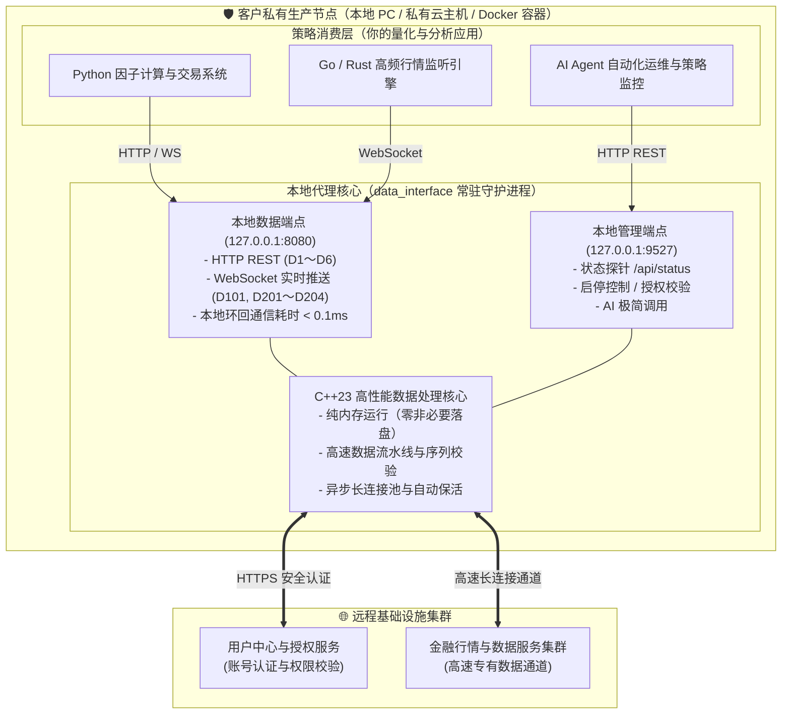

# 本地程序接口方案优势与市面方案对比

> 本文系统阐述 `data_interface` 为何采用“**本地 C++ 原生常驻代理 + 标准通用接口**”的架构模型，并全方位对比市面上常见的第三方云端 SaaS、语言强绑定 SDK、自写爬虫脚本及传统客户端挂钩等方案。

---

## 1. 架构总览与核心设计理念

在量化交易、行情监控和金融数据分析系统中，数据接入层通常是整个系统稳定性与延迟表现的命脉。市面上常见的接入方案往往在**网络延迟**、**策略隐私**、**语言绑定**与**系统稳定性**之间存在难以调和的妥协。

`data_interface` 采用了一种经过工业界验证的高可用架构——**本地 C++23 原生常驻代理（Local Native Daemon Proxy）**：

```text
┌─────────────────────────────────────────────────────────────┐
│ 用户私有环境（本地开发机 / 私有云服务器 / 无头 Docker 容器）     │
│                                                             │
│   ┌────────────────────────┐        ┌───────────────────┐   │
│   │ 你的量化策略 / 业务引擎  │        │ AI Agent / 自动化 │   │
│   │ (Python/Go/Rust/C++等) │        │ 控制脚本          │   │
│   └───────────┬────────────┘        └─────────┬─────────┘   │
│               │ HTTP / WebSocket              │ HTTP REST   │
│               │ (127.0.0.1:8080)              │ (127.0.0.1: │
│               │ 本地环回耗时 < 0.1ms           │  9527)      │
│               ▼                               ▼             │
│   ┌─────────────────────────────────────────────────────┐   │
│   │           data_interface 本地常驻核心                 │   │
│   │  - C++23 高性能原生编译，常驻内存通常仅约 5MB           │   │
│   │  - 纯内存运行流水线，零非必要文件落盘                  │   │
│   │  - 连接自动保活、数据聚合组装、异常自动自愈            │   │
│   │  - 独立进程沙箱，策略崩溃互不干扰                     │   │
│   └──────────────────────────┬──────────────────────────┘   │
└──────────────────────────────┼──────────────────────────────┘
                               │ 高速长连接复用
                               ▼
                   ┌───────────────────────┐
                   │   金融数据服务集群    │
                   └───────────────────────┘
```

该架构将繁重的高频网络连接管理与数据组装下沉至高性能本地 C++ 守护进程中，同时向上层策略应用暴露工业标准的 HTTP (REST) 与 WebSocket 接口。

---

## 2. 五大主流方案全景对比矩阵

> 📌 **方案标识说明**：
> - **第一列【🌟 我们的方案】**：即当前 `data_interface` 所采用的“本地 C++23 原生常驻代理 + 通用接口”模式；
> - **后四列（方案 A～D）**：为市面上量化与金融数据接入常见的其他替代方案。

| 评估维度 | 🌟 【我们的方案】<br>**data_interface 本地原生代理** | 方案 A<br>云端集中式 SaaS / 第三方 Web API | 方案 B<br>语言特定重型 SDK / 动态库 (DLL) | 方案 C<br>自写爬虫脚本直连 | 方案 D<br>传统交易软件挂钩 / 窗口 Hook |
|---|---|---|---|---|---|
| **端到端网络延迟** | **极低（微秒级本地环回）**<br>直连节点，本地 `127.0.0.1` 耗时 < 0.1ms | **高（双重公网跳转）**<br>数据源→中转云→本地，多次跨公网往返 | **低（本地直接调用）**<br>但受制于宿主语言运行环境与 GC 停顿 | **中等至高**<br>解释型语言网络栈与解析耗时不可控 | **极高**<br>依赖界面渲染与系统消息循环分发 |
| **策略隐私与安全** | **绝对安全（零数据外泄）**<br>请求与监控标的池仅在本地内存，无第三方中转 | **高风险**<br>订阅池、频次、策略标的全在第三方云端日志中，存在抢跑隐患 | **安全**<br>在本地运行 | **较安全**<br>但脚本维护易泄露凭证 | **较安全**<br>在本地运行 |
| **技术栈与语言自由** | **完全自由（语言中立）**<br>Python / Go / Rust / C++ / C# / Java / Shell 通用 | **自由**<br>通用 HTTP/WS，但受制于网络延迟和接口形态 | **极差（强绑架）**<br>仅限特定语言与指定编译器版本（如指定 Python 3.8） | **一般**<br>主要依赖 Python 生态，迁移其他语言需全量重写 | **极差**<br>通常必须绑定 Windows 系统与特定自动化库 |
| **进程级故障隔离** | **强隔离（独立进程沙箱）**<br>策略崩溃不影响数据长连，服务异常不拖垮策略 | **强隔离**<br>独立网络边界 | **无隔离（致命隐患）**<br>DLL 出现野指针或段错误，直接导致宿主策略进程瞬间挂死 | **强隔离**<br>独立脚本运行 | **极弱**<br>外部客户端弹窗或崩溃直接导致 Hook 中断 |
| **系统资源消耗** | **极致轻量（通常仅约 5MB）**<br>C++23 原生编译，常驻内存通常仅约 5MB，极低 CPU 负载 | **轻量**<br>本地开销小，但依赖远程带宽与第三方可用性 | **中等至高**<br>依赖重型运行环境，内存开销大 | **较高**<br>Python 高频解析二进制流导致 CPU 占满与 GC 频繁 | **极其臃肿**<br>必须开启庞大的桌面客户端，占用数 GB 内存与显存 |
| **无头/云端/AI 支持** | **原生深度支持（提供管理 REST）**<br>提供完整本地管理 REST API（9527），一键无头运行与自愈 | **支持**<br>标准 HTTP 调用 | **差**<br>需编写复杂的包装层，跨平台无头部署困难 | **支持**<br>命令行脚本运行 | **完全不支持**<br>无法在无桌面 Linux 服务器或 Docker 中运行 |
| **协议维护与升级成本** | **零维护成本（核心透明升级）**<br>服务升级由客户端透明完成，上层标准接口保持稳定向后兼容 | **低**<br>由云厂商维护，但定制化与深层字段受限 | **高**<br>每次底层变更需更新库、重新编译，易引发 ABI 兼容地狱 | **极高（负担沉重）**<br>接口变动即导致脚本瘫痪，日常维护吞噬研发精力 | **极高**<br>界面版本微调或反作弊更新即导致 Hook 失效 |
| **磁盘与痕迹残留** | **严格零非必要落盘（纯内存流）**<br>纯内存流式处理，磁盘无网络缓存或交易标的明文 | **视客户端实现而定** | **视实现而定** | **易产生临时文件与日志泄露** | **产生大量本地缓存、日志与界面临时文件** |

---

## 3. 六大核心技术优势深度解析

### 优势一：消除双重公网延迟，微秒级环回转发（C++23 硬件级加速）

在毫秒必争的量化行情与微观结构捕捉中，**物理距离与网络跳转次数决定了数据到达的最早时限**。

- **传统第三方云端 SaaS 的物理劣势**：
  必须经历 `数据源 ──(公网)──> 第三方中转云 ──(公网)──> 你的本地机器` 的双重公网传输。跨区域网络抖动、中转服务器带宽拥堵或机房网络丢包，会导致盘口快照（Snapshot）和逐笔数据（Tick）严重滞后，极易引发滑点。
- **【我们的方案】data_interface 本地原生代理**：
  本地程序直接与最近的数据源节点建立高吞吐、持久化长连接通道；你的量化策略程序与本地代理之间，通过操作系统内建的**环回网络接口（`127.0.0.1` Loopback）**进行高速通信，通信耗时通常在 **0.05ms～0.1ms（微秒级）**，相比公网中转有数量级的优势。
- **现代化 C++23 内核**：
  核心进程使用现代 C++23 原生编译，内部热路径实行零动态内存分配优化，搭载高性能轻量级 JSON 编解码引擎进行高速数据流转换，常驻内存通常仅约 5MB，单核即可轻松吞吐数万笔/秒的逐笔委托与成交流。



---

### 优势二：真正的语言中立与全栈生态解耦（告别依赖地狱）

许多量化方案要求用户必须安装特定版本的 Python（如限定 Python 3.8/3.9），或者引入特定编译器编译的 C++ 动态链接库（DLL / .so）。一旦用户的生产项目基于 Python 3.12、Go、Rust、Java、C# 或 Node.js，立刻陷入依赖地狱与 ABI 不兼容困境。

- **协议标准化**：`data_interface` 对外输出的是全球通用的标准协议——**HTTP RESTful API** 与 **WebSocket 实时推送流**。
- **任意语言均可开箱即用**：
  - **Python**：使用标准库 `urllib.request` 或 `requests` / `websockets` 即可直接取数；
  - **Go / Rust**：直接接入高性能异步通道，无需通过 cgo 或 FFI 进行昂贵的跨语言内存拷贝；
  - **终端与脚本**：甚至只需一行 `curl` 或 `wscat` 即可完成数据拉取与调试；
  - **前端与可视化**：浏览器原生支持 WebSocket，无需后端转发即可直接渲染实时动态盘口。
- **三平台免安装单文件分发**：
  Windows（AMD64）、macOS（Apple Silicon ARM64）、Linux（AMD64）三端均采用完全独立的单文件绿色交付，**完全不依赖系统安装 Python、GCC 或第三方运行时环境**，解压双击即可启动。

---

### 优势三：进程级沙箱故障隔离（Process-Level Fault Isolation）

在实盘交易与 7×24 小时长期运行的策略系统中，**容灾与崩溃隔离**是关乎本金安全的核心防线。

- **传统 C/C++ DLL 模式的致命风险**：
  当把第三方提供的动态链接库直接加载进交易策略主进程时，由于共享相同的虚拟内存地址空间，一旦动态库出现哪怕一次空指针引用、越界读写或内存损坏，操作系统会立即触发段错误（SIGSEGV / Access Violation），**导致整个交易系统被强制强行杀死**，未挂出的撤单、未对冲的头寸将瞬间失控。
- **【我们的方案】独立进程沙箱隔离优势**：
  `data_interface` 与你的交易策略运行在各自完全独立的操作系统进程空间内。
  - **策略重启不丢状态**：当你的策略程序进行日常热重载、参数微调或发生未捕获异常退出时，本地数据服务始终保持与行情服务集群的持久长连接，策略重启拉起后通过 `127.0.0.1` 瞬间恢复数据消费，无需重复经历漫长的鉴权、握手与建连流程；
  - **数据故障不拖垮交易**：数据代理内置完善的连接池健康监测、心跳维持与指数退避重试，即便遇到公网瞬时断开也能平滑自愈，绝不会导致外部交易主逻辑发生内存污染或硬崩溃。

---

### 优势四：严格零非必要落盘与绝对商业隐私安全（Zero Persistence & In-Memory）

对于专业量化团队、私募基金与高阶交易员而言，**交易策略的监控股票池、交易标的、触发阈值和调仓频率是绝对核心的商业机密**。

- **云端集中式 SaaS 的潜在隐患**：
  在第三方云 API 模式中，所有请求必须由第三方的中心服务器接收并解析。这意味着：
  1. 你的每日关注股票清单、特定分时查询频次完整留存在第三方的服务器日志中；
  2. 极易被第三方基于大数据推断出你的选股逻辑与仓位模型，甚至产生恶意“抢跑”或策略撞车的风险；
  3. 一旦第三方云服务遭遇安全事件，用户的核心交易足迹将面临全量泄露。
- **【我们的方案】本地纯内存隔离与隐私壁垒**：
  所有的策略计算、多因子打分、标的过滤、触发决策均在你的**本地机器或私有服务器内存**中完成。
  - **本地闭环**：外部世界只看到标准的数据流，无法知晓你具体消费了哪条数据、用于何种策略逻辑；
  - **严格零非必要落盘（Strict Zero-Persistence Invariant）**：
    除必要的本机配置文件外，程序在运行期间**严禁向磁盘落盘任何运行时网络缓存、标的 IP 列表、查询历史或明文数据包**。全流程采用纯内存流水线（Pure In-Memory）处理，从存储物理层阻断任何商业机密与临时文件的痕迹泄露。

---

### 优势五：繁重网络通信细节完全封装，业务层只享“纯净数据”

现代金融市场高密度深度行情（如逐笔委托、逐笔成交与深度盘口快照）数据吞吐量极其巨大。如果由策略研发人员自己编写网络连接代码，往往会导致大量精力被网络抖动、断线重连与流控对齐等繁重的工程细节所消耗。

`data_interface` 将这些复杂的网络与长连管理在本地 C++ 服务中全部封装完毕，向上层统一输出**清洗完毕、结构规整、字段语义明确的标准 JSON 或 CSV 数据流**。策略团队无需关心网络连接运维细节，开箱即用，专注于产生核心超额收益（Alpha）。

---

### 优势六：面向云原生与 AI 时代的无头自动化设计（Headless & AI Native）

随着自动化量化与 AI Agent 辅助交易的普及，程序不再仅仅运行于带有显示器的个人 PC，而越来越普遍地部署在**无桌面环境的 Linux 云主机、私有 VPS、Docker 容器以及自动化调度系统**中。

- **传统方案的无头缺陷**：
  传统客户端挂钩或窗口自动化工具强依赖图形界面（GUI）渲染和系统消息循环，一旦放入云服务器或 Docker，直接由于缺少显卡驱动、无 X11/Wayland 桌面而崩溃无法工作。
- **【我们的方案】双模原生设计（桌面 GUI + 无头 REST）**：
  - **桌面模式**：在 Windows / macOS / Linux 桌面环境下，提供原生超轻量管理窗口与控制面板；
  - **无头/云端模式**：在无界面的 Linux 云主机或远程容器中，只需后台常驻运行，提供专用的**本地管理 REST API（端口 `9527`）**；
  - **AI Agent 极简调度**：AI 智能体或运维脚本无需操控任何复杂的图形界面，直接通过标准 HTTP 请求即可完成状态探测（`GET /api/status`）、免人工交互登录（`POST /api/login`）、启停数据服务（`POST /api/server/start`）与故障自诊断，真正实现 7×24 小时无人值守。

---

## 4. 架构拓扑深度剖析



---

## 5. 典型应用场景选型建议

| 业务场景 | 痛点诉求 | 本方案落地实践与推荐姿势 |
|---|---|---|
| **毫秒级高频监控与瞬态捕捉**<br>（打板/撤单/盘口委托异动） | 传统云 API 延迟高、抖动大、丢包严重；DLL 崩溃易拖死主策略。 | 启用本地 WebSocket 推送（如 D201、D203、D204 模块），利用本地微秒级环回通道，毫秒级捕捉盘口分笔与撤单明细。 |
| **多语言、多模块分布式量化架构** | 交易引擎用 C++/Rust 编写，投研用 Python，监控用 Go，多语言难以统一接入 SDK。 | 本地代理统一监听 `8080` 端口，各语言通过标准 HTTP/WebSocket 协议并发连接，完全解耦技术栈。 |
| **云端 7×24 小时无人值守交易节点** | 没有桌面环境，无法登录图形界面；需要自动巡检与故障自愈。 | 参考[无界面服务器与 AI 自动化操作](无界面服务器与AI自动化操作.md)，使用 systemd / supervisord 托管进程，由脚本或 AI 调用管理 API 全自动起停与自测。 |
| **高敏感度专有策略与私募投研** | 严禁任何策略逻辑、监控标的池和查询频次泄露给外部第三方平台。 | 数据服务纯内存流式转发，零磁盘文件残留，所有策略筛选与运算 100% 本地闭环，从物理层杜绝数据外泄。 |

---

## 6. 总结

`data_interface` 的设计哲学非常明确：

> **把长连保活、数据组织、并发排队和连接管理的繁重工作，交由高性能 C++23 原生引擎在本地高效消化；把最低的时延、最纯净的数据、最自由的技术栈和最放心的策略隐私，完整留给用户的上层业务。**

无论是个人量化极客、专业投研机构，还是面向未来的 AI 自动化系统，本地程序接口方案都提供了在性能、安全、工程规范与集成成本之间最优的工程解。
